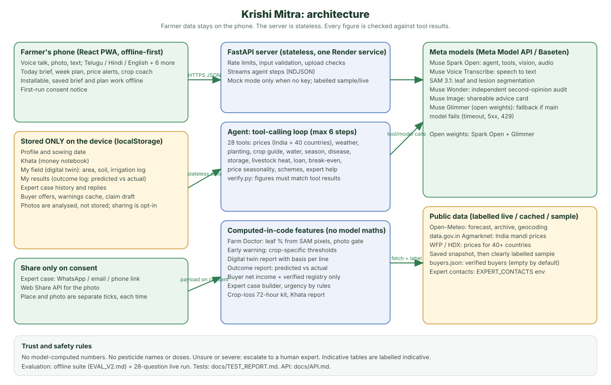

# 🌾 Krishi Mitra: a voice-first farming agent in Telugu, Hindi and English

Built for the **Meta Global AI Developer Hackathon** (Indie track, "Build for Your World").
**Everything in this repository was built during the hackathon window (Oct 27 – Nov 4, 2026).**

## The problem
Small farmers in India often cannot type long questions, read English websites, or find out which
government schemes they qualify for. Prices, weather and expert advice live in different places.
Krishi Mitra lets a farmer **speak** (or type, or send a **photo** of the crop) in their own language and get a
short, practical answer, read aloud if they want.

## What it does
- **Voice in, in any of 3 languages:** Telugu, Hindi, English (auto-detected, or pick one).
- **Photo to action plan:** one crop photo goes through the *same agent* (vision + tool calling): it names the likely problem and how sure it is, checks the weather to time spraying, mentions crop insurance if there is real loss, and sends the farmer to a human expert when unsure.
- **Multi-turn:** follow-up questions work ("and groundnut?"). Quick-ask buttons for common questions.
- **A real agent, not a chatbot:** the model decides which tools to call, in several steps:
  `get_mandi_price`, `best_markets` (where to sell for the highest price) and `get_price_trend` (rising or falling? sell now or wait?), all from Agmarknet via data.gov.in, `get_weather` (Open-Meteo),
  `check_schemes` (PM-KISAN, PMFBY, KCC, state support, with the documents needed), `calculate_revenue` (exact income maths, never done by the model), `get_expert_help` (Kisan Call Centre 1800-180-1551), plus the advisor tools below (`get_msp`, `net_market_value`, `spray_window`, `lookup_problem`, `hold_or_sell`).
- **Live agent steps:** the answer streams its progress ("checking mandi prices… checking weather… re-checking figures") so the farmer, and the judge, can see the agent working. Endpoints: `/api/agent/stream` and `/api/diagnose/stream` (newline-delimited JSON).
- **Sell now or wait:** the agent combines the price trend, best markets and the weather forecast into one clear recommendation (guidance, not a guarantee).
- **The agent can always talk:** browser voice when the device has one for the language, otherwise a server-generated voice (`/api/tts`, gTTS), so Telugu and Hindi are audible even on laptops without those voices.
- **Works on weak networks:** installable PWA with an offline shell; saved answers stay readable and playable offline; large-text mode for older farmers.
- **Verification layer (idea from Meta's Agents 102 workshop):** every figure in the final answer must come from a tool result.
  Otherwise the answer is sent back for a rewrite, and if it still fails the farmer sees an explicit "could not verify" warning, never a confident made-up number.
- **Honest about limits:** no pesticide doses, escalates to a human expert when unsure, says when price data is sample data.
- **New chat UI:** WhatsApp-style conversation, hands-free **voice conversation mode** (listen, answer, speak, listen again, with automatic end-of-speech detection), mic button with live waveform, **photo upload** from camera, gallery or drag-and-drop with preview (add a spoken or typed question to the photo), **read-aloud** for every answer (Telugu/Hindi/English voices, auto-read option), rich cards for mandi prices, best markets, weather, schemes (with documents) and income calculator, one-tap call to the Kisan Call Centre, light/dark theme, installable as a phone app (PWA manifest).
- **Listen button** (browser speech synthesis), **share on WhatsApp**, **farmer profile** (state, district, land, crop; saved on the device), typed input fallback.

## How Meta models are used
- **Muse Spark Open** (`meta-models/muse-spark-open-1026`, open weights, served on Baseten): chat, tool calling, image understanding, and audio understanding for speech transcription.
- Provider switch in `backend/app/config.py`: `PROVIDER=baseten` (open weights) or `PROVIDER=meta` (Meta Model API).

## Architecture


**Docs:** [API reference](docs/API.md) · [How each Meta model is used](docs/MODELS.md) · [Test report](docs/TEST_REPORT.md) · [Evaluation v2](EVAL_V2.md) · [3-minute demo script](DEMO.md) · [Recording checklist](docs/RECORDING_CHECKLIST.md)

React (Vite) frontend → FastAPI backend (`backend/app`) → Muse Spark Open. One Docker service serves both.
`agent.py` (tool loop + progress events) · `tools.py` (7 tools, live data with fallbacks) · `tts.py` (server voice fallback) · `verify.py` (answer verification) · `lang.py` (3 languages) · `meta_client.py` (model client, WebM→WAV conversion for audio).

## Demo and submission
See [DEMO.md](DEMO.md) for the 3-minute demo script and submission checklist.

## Tests (offline, no API key needed)
```bash
cd backend && python tests/test_verify.py && python tests/test_tools.py && python tests/test_stream.py && python tests/test_hardening.py && python tests/test_grounding.py && python tests/test_whatsapp.py && python tests/test_advisor.py && python tests/test_planner.py && python tests/test_meta_extras.py && python tests/test_plan.py && python tests/test_khata.py
```

## Run locally
```bash
cd backend && python -m venv .venv && source .venv/bin/activate
pip install -r requirements.txt            # ffmpeg must be installed for voice
cp ../.env.example .env                    # add BASETEN_API_KEY (and optional DATA_GOV_API_KEY)
uvicorn app.main:app --reload --port 8000
cd ../frontend && npm install && npm run dev
```
Without an API key the app runs in **mock mode** (fake answers, for UI development only).

## Deploy (Render)
Docker web service using the root `Dockerfile`. Environment variables: `PROVIDER=baseten`, `BASETEN_API_KEY`,
`OPEN_MODEL=meta-models/muse-spark-open-1026`, optional `DATA_GOV_API_KEY` (free key from data.gov.in for live mandi prices).

## WhatsApp channel (Meta WhatsApp Cloud API)
Farmers who will not install an app can use the same agent on WhatsApp: send a **text**, a **voice note** (answered in text and a voice reply) or a **crop photo**. Same tools, same verification layer (`backend/app/whatsapp.py`).
1. developers.facebook.com → create an app → add the **WhatsApp** product → use the test number.
2. Set on Render: `WHATSAPP_ACCESS_TOKEN`, `WHATSAPP_PHONE_NUMBER_ID`, `WHATSAPP_APP_SECRET` (App settings → Basic), `WHATSAPP_VERIFY_TOKEN` (any string you choose). Optional: `WHATSAPP_ALLOWED_NUMBERS` (comma separated, digits only) to restrict who can use the bot, `WHATSAPP_VOICE_REPLY=0` to turn voice replies off.
3. WhatsApp → Configuration: callback URL `https://<your-app>.onrender.com/webhook/whatsapp`, the same verify token, then subscribe to the **messages** field.
4. Add your phone as a test recipient and send "hi". Commands: `/district Kurnool`, `/crop Groundnut`, `/land yes`, `/reset`, `/help`.
Safety: requests are accepted only with a valid `X-Hub-Signature-256`, duplicate deliveries are answered once, each sender is rate limited, and no tokens are stored in the repo. The temporary token expires in 24 hours; for a longer demo create a System User token.

## Stronger verification and saved data
- **Field-aware verification:** money figures must come from a price/amount field in a tool result (a year, phone number or rain percentage cannot be passed off as a price); percentages, temperatures and rainfall must match a weather/trend field (rounding allowed); other 3+ digit numbers must appear in a tool result. The result reports how many figures were checked.
- **Saved real data, never invented:** if data.gov.in is slow or down, the agent uses a dated snapshot of real Agmarknet prices (`python scripts/snapshot_mandi.py`, needs your free `DATA_GOV_API_KEY`), labelled "Saved data" in the UI and in the answer. Only if no snapshot exists does it fall back to clearly-labelled sample data.

## Production safety
- Per-IP rate limits on the model, voice and TTS endpoints (default 12 agent requests/min, 20 voice requests/min; `RATE_AGENT_PER_MIN`, `RATE_VOICE_PER_MIN`), so a public demo URL cannot burn the API credits.
- Public data (Agmarknet, weather) is cached for 10 minutes (`CACHE_TTL_S`, 0 = off); failed lookups are never cached.
- Independent tool calls from one model turn run in parallel.
- `/api/debug/*` and `/api/models` are hidden unless `DEBUG_ENDPOINTS=1`.
- CI (GitHub Actions) runs the offline tests and the frontend build on every push.

## Advisor tools (new)
Five more tools (and two below) in `backend/app/advisor.py`, same rules as the rest: exact arithmetic in code, labelled sources, no invented numbers.
- `get_msp`: government Minimum Support Price per quintal (Kharif 2026-27, Rabi 2027-28 now being sown, Rabi 2026-27) from CCEA announcements in `data/msp.json`. Says MSP applies only to what the government buys.
- `net_market_value`: what a farmer really takes home from a market after commission, loading and transport, to compare a near market with a far one that pays more. Cost rates are labelled assumptions.
- `spray_window`: which of the next days suit spraying (rain chance, wind, heat). Never a dose.
- `lookup_problem`: 20 common problems for paddy, groundnut, cotton, chilli, tomato and maize matched from the farmer's own description (`data/problems.json`). Gives symptoms, field checks and non-chemical steps only, never a pesticide name or dose, and always sends the farmer to the agriculture officer.
- `hold_or_sell`: one sell-now / hold-a-little / ask-about-procurement recommendation from the price trend, best market and MSP (fixed rules, perishable crops are always "sell now").
The chat shows a card for each. MSP figures were checked on 29 Oct 2026; update `data/msp.json` when new MSPs are announced.

## Daily brief, irrigation and KCC interest (new)
- **Today button (`/api/brief`, WhatsApp `/brief`):** one tap gives today's weather, whether to irrigate, whether it is a good day to spray, the price of the farmer's main crop, the price trend, MSP comparison and a sell/hold guide, in Telugu, Hindi or English. It is built from tool results with fixed templates (no model call): instant, works without an API key, and every figure still passes the verification layer.
- `irrigation_advice`: irrigate or wait, from the rain forecast and heat (the farmer is told to check the soil by hand).
- `kcc_interest`: Kisan Credit Card crop-loan interest at 7% (4% effective if repaid within a year), exact rupees and the saving; the benefit applies on up to Rs 3 lakh (checked Oct 2026, rules are renewed every year, the bank gives the final figure).

## Planning, alerts and risk warnings (new)
- **`sell_plan` (where to sell after transport):** ranks the best-paying markets by the money that actually reaches the farmer's hand, using the distance from the farmer's village (Open-Meteo geocoding, straight line x 1.3 for roads), commission, loading and transport. A far market that pays Rs 100 more per quintal can lose to a near one; the card shows exactly why. Rates are labelled assumptions.
- **`compare_crops` (which crop to grow):** for kharif or rabi and any number of acres, ranks crops by expected profit using indicative yield and cost per acre (`data/crop_economics.json`, clearly labelled as assumptions) and the latest mandi price (or MSP when there is no market price). It also shows the profit if the price falls 10%, water need and crop duration, so risk is visible.
- **Price alerts (bell icon):** "tell me when groundnut goes above Rs 7,500". Alerts stay on the phone (no account, no personal data on the server); the app checks `/api/alerts/check` every 15 minutes, when it comes back online and on demand, and shows a banner and a phone notification. **Only live prices can trigger an alert**: sample or saved data never says "price reached".
- **Weather risk warnings in the Today brief:** heat (40 degC or more), heavy rain (25 mm or more) and strong wind (40 km/h or more) are called out with the worst day and what to do, in Telugu, Hindi and English, and pass the same verification layer.
- **Hardening:** the rate limiter now trusts only the address added by the proxy (a client can no longer dodge it with a fake `X-Forwarded-For`), idle clients are swept from memory, uploads are type- and size-checked (photos 8 MB, audio 10 MB), and the agent's "could not finish" message is in the farmer's language. `/api/health` reports the tool count and whether live prices are on.
- 16 tools in total; 10 new offline tests in `backend/tests/test_planner.py`.

## Khata and crop-loss kit (new)
- **📒 Khata (voice farm ledger):** say "bought urea for 1500" or "sold 8 quintals groundnut at 7000" in Telugu, Hindi or English (typed or by voice). The model only **extracts** one entry (`/api/ledger/parse`, with a rule-based fallback if the model is down); an amount that is not clearly in the farmer's own words is flagged, and the farmer always confirms before saving. Entries stay **on the phone** (no account). One tap gives a **season report** (income, cost of cultivation, net, cost per acre, where the money went, per crop), computed exactly in code, shareable on WhatsApp or as CSV: the record a bank or insurer asks for and most farmers do not have.
- **🌧️ Crop-loss kit (`/api/claim/draft`):** the PMFBY rule that costs farmers their claims is the **72-hour intimation window** for localized calamities (hailstorm, local flooding, landslide, cloudburst, fire) and for harvested crop drying in the field. The kit computes the exact deadline with a live countdown, gives the checklist (photos, policy number, land records), the helpline numbers and a ready message to send, in three languages. It is honest where there is no individual claim: for drought or widespread pest it says losses are assessed area-wide by the government and sends the farmer to the agriculture officer instead of inventing a deadline. Rules are summarised from the PMFBY guidelines: confirm with the insurer.

## Week plan and more schemes (new)
- **📅 This week (`/api/plan`):** one tap and the agent looks at the next 7 days and decides what to do, ranked **Do first / This week / Good to know**: heavy rain, heat or wind warnings, sell-or-hold and "below MSP" for the main crop, the next good irrigation day, the best spraying day, and the schemes the farmer qualifies for, with a 7-day strip (weather, irrigate, spray). Fixed rules and templates in Telugu, Hindi and English, no model call, and every figure passes the verification layer. If the forecast is unavailable it says so instead of planning blind.
- **Six more schemes** in the scheme check, each with documents and where to apply: Soil Health Card, e-NAM, PM Kisan Maan-Dhan pension, PMKSY drip/sprinkler subsidy, PM-KUSUM solar pumps, Agriculture Infrastructure Fund. Subsidy rates that differ by state are not quoted; the card sends the farmer to the office to confirm.

## More of Meta's model family (new, optional)
The core agent runs on **Muse Spark Open** (open weights, Baseten). With a Meta Model API key (`MODEL_API_KEY`, works alongside `PROVIDER=baseten`) three more Meta models switch on. Nothing in the existing flow changes; each feature is a separate endpoint and degrades gracefully without the key. `GET /api/meta-models` shows which models a deployment uses.
- **Muse Voice Transcribe** (`muse-voice-transcribe-1.0`) through `/api/asr`: a dedicated speech model for Telugu/Hindi/English voice questions. If the call fails, the app falls back to the Spark Open audio path, so voice never stops working.
- **SAM 3.1** (`sam-3.1`) through `/api/leaf-scan` (button "Measure damage" on a photo): segments "diseased leaf spot" and "leaf", and the damage percentage is **computed in code from the masks** (the model finds the regions, never the number). It is a measurement, not a diagnosis: no disease name, no pesticide, heavy damage points to the Kisan Call Centre. Masks are decoded with Meta's official `meta-sam-parser`.
- **Muse Image** (`muse-image-1.0`) through `/api/advice-card` (button "Card" under an answer): turns the first sentence of an already-verified answer into a shareable card for WhatsApp groups. Only that sentence is put on the card, so no new figures can appear.
Tested offline with a mocked Meta API (`backend/tests/test_meta_extras.py`). Run these against the live API once with your key before recording the demo.

## Global mode: any country, any language (new)
Krishi Mitra is not India-only. Pick a country in "My details" (40 countries + Other) and the app switches:
- **Prices:** `get_market_price` reads WFP food-price data from the Humanitarian Data Exchange (open data, many developing countries). It is monthly data, so every answer says how old it is. If a country has no data, the agent asks the farmer for the price he was offered and uses `calculate_revenue`. It never invents a price.
- **Money:** answers use the farmer's own currency (KES, NGN, BRL...). The verification layer checks currency amounts the same way it checks rupees.
- **Languages:** Telugu, Hindi and English plus Spanish, French, Portuguese, Swahili, Indonesian and Bengali. For any other language the agent mirrors the language the farmer wrote in. Voice (Muse Voice language bias, browser voices, server TTS) follows the chosen language.
- **India-only features stay India-only:** MSP, PMFBY claim kit, Kisan Call Centre, Agmarknet alerts and Indian schemes are switched off abroad (claim kit gives a generic "check your policy" guide), so a farmer elsewhere never sees a wrong rupee figure or wrong helpline.
- Weather (Open-Meteo), the daily brief, week plan, Khata and photo advice work anywhere.
- Tests: `backend/tests/test_global.py`. The HDX endpoint could not be reached from the build sandbox, so test it once live: ask for maize prices with country Kenya.

## Second opinion with Muse Wonder (new)
Under every answer that used tools, a "Second opinion" button asks **Muse Wonder** (Meta's reasoning model, `muse-wonder-1.0`) to audit the answer written by Muse Spark Open. Wonder sees only the tool results and the answer, and says whether the advice follows from the data and which caution is missing. The number check still runs in code and always wins: if a figure is not in the tool results the verdict is "issues" whatever the model says. Two Meta models, one hard code check. Endpoint: `POST /api/second-opinion`; works without a key as a code-only check. Tests: `backend/tests/test_audit.py`.

## Planting window, frost warning and a self-run evaluation (new)
- **Planting window** (`planting_window`, any country): soil temperature, soil moisture, coming rain and frost from Open-Meteo decide "sow now / wait", computed in code. Germination temperatures are indicative guidance (`data/crop_planting.json`); the card tells the farmer to check the soil by hand.
- **Frost warning** in the daily brief (night at or below 2 C), in all brief languages.
- **Evaluation:** `cd backend && python eval/run_eval.py --out ../EVAL.md` runs 28 questions (India, Kenya, Brazil; 6 languages) through the live agent and reports right-tool rate, share of answers whose figures all verify (and with no India-only terms abroad), rewrites and latency. Run it once on your deployment and quote the numbers.

## Crop coach: a guide for every farmer (new)
Enter the sowing date in "My details" and Krishi Mitra becomes a coach (`crop_guide`, any country, 16 crops): it works out the growth stage, lists the few jobs that matter this week (weeding, scouting, feeding check, harvest and storage planning), counts days to the expected harvest, and raises an urgent line when the most water-sensitive stage meets a dry week (rain forecast from Open-Meteo). It also appears in the week plan, in Telugu, Hindi and English. Durations are indicative and labelled so; it never names pesticides or doses. Tests: `backend/tests/test_coach.py`.

## Season check and Muse Glimmer fallback (new)
- **Season check** (`season_check`, any country): rain and temperature of the last 30 days against the same 30 days of the last 10 years (Open-Meteo historical archive), computed in code: "rain is 45% of normal". Shown as a card, in the week plan (dry or wet season line in te/hi/en) and available to the agent for "is this a drought year?". Archive data lags about 5 days and covers a grid cell, so it is a planning signal, not a forecast.
- **Muse Glimmer fallback** (open weights, Apache 2.0, about 30B, runs on one GPU): set `GLIMMER_BASE_URL` (any OpenAI-compatible server: vLLM, SGLang, Fireworks, Modal), optional `GLIMMER_API_KEY` and `GLIMMER_MODEL` (default `meta-models/Muse-Glimmer-30B`). If the main model call fails with a timeout, connection error, 5xx or 429, the same request goes to Glimmer so the farmer still gets an answer. A cooperative can also run it on a local machine. Shown in `/api/meta-models`. Tests: `backend/tests/test_climate.py`.

## Water plan: save water, energy and money (new)
`water_plan` (any country, 16 crops) uses the FAO-56 method in code: crop water use = reference evapotranspiration (Open-Meteo forecast) x crop coefficient that follows the growth stage from the sowing date, minus the rain the soil can use. The result: millimetres and litres for the farmer's acres this week, the day to irrigate by, and how much rain 100 m² of roof or pond catchment could store (rainwater harvesting). It appears as a card and as a line in the week plan (te/hi/en). Crop coefficients are typical FAO-56 values, indicative. Tests: `backend/tests/test_water.py`.

## Everyday farm problems (new)
Five more tools, all computed in code, any country, no medical or chemical advice: **grain storage** (`storage_check`: safe moisture limits, good drying days, damp-air warning, mould warning), **livestock heat** (`livestock_heat`: temperature-humidity index for cattle and buffalo, air temperature for poultry, from the 5-day forecast, with simple shade-water-feed actions), **loan cost** (`loan_compare`: total interest, fees and the real yearly rate, so a "3% a month flat" trader loan is shown for what it costs next to a bank loan), **fertiliser value** (`compare_inputs`: cost per kg of N, P2O5 and K2O, never how much to apply) and **break-even price** (`breakeven_price`). Cards in te/hi/en. Safe-moisture limits and heat bands are common guide values (indicative). Tests: `backend/tests/test_farmtools.py`.

## Disease weather watch and offline guidance (new)
- **Disease weather watch** (`disease_risk`, any country): from the hourly forecast it counts the humid (90% or more), mild (10 to 30 C) hours per day, a standard leaf-wetness proxy for fungal disease, and warns when to inspect the crop. For potato and tomato it also applies the classic late-blight "Smith period" rule. It is a weather warning, never a diagnosis, and never names a chemical. Appears as a card and in the week plan (te/hi/en). Tests: `backend/tests/test_pestwatch.py`.
- **Offline guidance:** the latest daily brief and week plan are saved on the device. With no signal, tapping Today or This week shows the saved version labelled "Saved guidance (no internet)" with its time, so a farmer in a dead zone still has yesterday's advice.

## WhatsApp, now global (new)
The WhatsApp channel (the app farmers already use) works worldwide: `/country KE` (or a country name), `/sowing 2026-09-01`, `/lang es|fr|pt|sw|id|bn|te|hi|en`, `/brief` and `/plan` (today and this week, no model call, in the chosen language or a country-based default). All new tools (planting, water, coach, season, disease, storage, loans...) answer through the same agent. Voice notes go to Muse Voice Transcribe with the farmer's language as a hint (falling back to Spark Open) and voice replies use the chosen language. Tests: `backend/tests/test_whatsapp_global.py`.

## Best months to sell (new)
`price_seasonality` (outside India): from up to six years of WFP monthly prices it computes a seasonal index per calendar month (each price divided by that year's average, so inflation cancels), shows the months that are usually highest and lowest and the gap between them. Most smallholders sell at harvest, when prices are lowest; this turns "should I store and wait?" into a number to weigh against storage cost, losses and interest. It refuses when there are fewer than two usable years. History, not a forecast. Tests: `backend/tests/test_seasonality.py`.

## Farm Doctor visual evidence (new)
`/api/leaf-scan` (SAM 3.1) now returns evidence, not just a percentage: **photo quality** (brightness and sharpness, simple image statistics with heuristic thresholds), **reliability** (`clear`, `uncertain` or `retake`) with the reasons (low or doubtful mask confidence, whole leaf not found, damage close to a severity boundary, bad photo), the **model confidence** (mean and lowest), an **escalation** flag (severe damage, or a measurement not reliable enough to act on alone) and **non-chemical safe steps** in Telugu, Hindi or English (`lang` form field). It never names a disease, a pesticide or a dose, and always says not to spray until an officer confirms. A blurry, dark or unrecognised photo asks for a retake with concrete tips instead of guessing. `needs_expert` stays for compatibility. Photo-quality thresholds were checked on synthetic images only: tune them on real field photos. Tests: `backend/tests/test_doctor.py`.

## Data honesty
- Mandi prices are live only when `DATA_GOV_API_KEY` is set and data.gov.in responds; otherwise the tool returns clearly labelled **sample data**.
- Scheme details are indicative and must be confirmed with the official office (links are returned by the tool).

## Progress log
- Day 1 (Oct 27): repo scaffold, FastAPI backend, Meta API client, voice-record UI, crop photo upload.
- Day 2 (Oct 28): agent loop with tools, mock mode, Baseten provider switch, answer verification layer, Docker deploy.
- Day 3 (Oct 29): photo-to-action-plan through the agent, multi-turn, best markets, revenue calculator, scheme documents, WhatsApp share, quick-ask buttons, transcription guard, image shrinking. Also: Telugu/English/Hindi, typed input, WebM→WAV audio fix for Baseten, weather + expert-help + live mandi tools, farmer profile, listen button.
- Day 4 (Oct 30): sell_plan, compare_crops, price alerts, weather risk warnings, rate-limit and upload hardening.

## Expert escalation (human in the loop)

When the agent or the SAM leaf scan is unsure, or damage is severe, the farmer can send **one structured case** to a human expert: symptom checklist, scan evidence (severity, confidence, reliability), live weather and disease-weather risk, crop day and stage, and a note, written in Telugu, Hindi or English.

- `POST /api/case/build` needs `consent.share_details`; the place is included only with `share_location`; no name or phone is ever sent. Urgency (high/medium/low) is computed by rules, not by a model. Nothing is stored on the server.
- `GET /api/expert/contacts` returns experts from the optional `EXPERT_CONTACTS` env (JSON list of `{name, type: whatsapp|email|phone, value, languages}`); otherwise the local extension office / helpline fallback.
- The photo stays on the phone and is shared via the Web Share API only if the farmer ticks it. Case history with status and the expert's reply note is kept on the device.
- Tests: `python tests/test_cases.py`.

## Outcome tracking ("My results")

Farmers log a recommendation (or save one straight from an agent answer), mark it done, enter the actual cost, yield and price, and say whether it helped. `POST /api/outcomes/report` computes the followed-rate, usefulness and **predicted vs actual** error (only where both were entered; nothing is invented) plus season spend, harvest value and net, in Telugu, Hindi or English. Records stay on the phone; the server is stateless. Tests: `python tests/test_outcomes.py`.

## Farm digital twin ("My field")

One living record of the field on the phone: place, area, soil, crop, variety, sowing date, irrigation log, spend and yield. `POST /api/twin/report` adds the crop calendar (stage, expected harvest) and the weather the field has actually lived through since sowing (live Open-Meteo archive: rain, wet days, longest dry spell, longest stretch with neither rain nor irrigation) and returns an **explainable** report: every line says its basis (farmer-entered, computed, live archive, indicative table). If the archive is down it says so instead of guessing. Stateless server. Tests: `python tests/test_twin.py`.

## Village early warning

`POST /api/warnings/check` turns the live forecast for the farmer's place into **crop-specific** alerts: heat, cold, heavy rain and strong wind (indicative per-crop thresholds in `data/crop_thresholds.json`, stricter in flowering/grain-filling, and rain limit drops near harvest) plus fungal-disease *weather* conditions (humid and warm hours; no disease is predicted). Each alert has its value, threshold, a watch/warning level and non-chemical preventive actions in te/hi/en; it always ends with "no spraying without advice". The app checks on the phone every 3 hours, shows a banner, keeps the last result for offline, and can send a browser notification if the farmer allows it. Tests: `python tests/test_warning.py`.

## Buyer offer comparison

The farmer enters the offers received (price, commission, transport, other costs, payment delay, advance asked). `POST /api/buyers/compare` computes the **net income** of each, ranks them, and flags risky terms (advance asked, payment after more than 7 days, price 25% or more above the farmer's reference price). A buyer is shown as **verified only** if the offer names an id in `backend/app/data/buyers.json` marked `verified: true` with who verified it and when; the shipped registry is empty, so nobody is verified by default, and name-only matches never count. Offers stay on the phone. Tests: `python tests/test_buyers.py`.

## Evaluation suite v2

`python eval/suite_v2.py --out ../EVAL_V2.md` runs, without a live model, checks of: numerical verification and fabricated-figure detection, an unsafe-advice scan (no pesticide names or doses in built-in text), the Farm Doctor photo-reliability gate on synthetic images, Telugu/Hindi completeness of every built-in table, cache and data-source labelling, failure recovery (Glimmer fallback, crashing tool, weather/archive down) and compute-only latency. Each section states what it does **not** prove. `--live` adds the 28-question agent run (tool selection, verified figures, real latency) when a model key is set. The committed `EVAL_V2.md` holds the offline run plus a real live run on the deployed Render service (2026-11-01, Muse Spark Open): 28/28 right tool, 28/28 all figures verified, median 7.4s, p95 12.9s. Caveats are in that file: the 28 questions are our own fixed set, not held-out, and latency is measured server-side.

Audit and security: [docs/AUDIT.md](docs/AUDIT.md) · [docs/SECURITY.md](docs/SECURITY.md) · [docs/DEPLOY.md](docs/DEPLOY.md). `/api/status` shows which Meta model served calls, with latency and error counts; answers show a "🧠 model" line.

## Water and pump cost

`POST /api/irrigation/report` turns the irrigation log (mm, optional pump hours) into water volume (1 mm on 1 acre = 4,047 litres), pumping cost (electric kW or diesel litres per hour, price, hours or pump flow), cost per mm and per acre, and **savings against the farmer's own entered baseline** (it can show "more used"; with no baseline it says so instead of inventing a saving). This week's recommended water (FAO-56 forecast, indicative) is priced at the farmer's own cost per mm. The log is shared with My field and stays on the phone. Tests: `python tests/test_irrigation.py`.

## Insurance evidence file and claim tracker

From the crop-loss kit, the farmer opens a **claim file** on the phone: ticks the document checklist, adds photos (shrunk, stored on the device) and notes, records the claim's progress (reported, documents submitted, survey, waiting, paid or rejected, with dates and who said what) and downloads a **printable evidence report** (`POST /api/claim/evidence`, HTML you can save as PDF; everything is HTML-escaped, only real small JPEG/PNG/WebP data URLs are embedded, at most 6). The only judgement it computes is arithmetic on the entered dates: was the loss reported within 72 hours (for localized calamities in India). It never estimates approval and every report says the insurer decides. Tests: `python tests/test_evidence.py`.

## Agent controls: confirm before acting, consented memory, tool router

- **Confirm first.** After an answer the app may *offer* to save the advice to "My results" or set a price alert (proposals built in code from tool results, e.g. alert at 5% above today's modal price). Nothing runs until the farmer taps Yes on the phone; No changes nothing. The server and the model never execute actions.
- **Memory with consent.** "My farm memory" is off by default. When switched on, a short list of facts the farmer keeps (editable, deletable, "forget everything") is sent with questions as quoted data (never as instructions, never as verified figures). The server stores nothing; the request must carry `memory_consent: true`.
- **Tool router.** Only tools relevant to the question (price, weather and water, crop care, money) plus three general ones are offered to the model; unclear questions get all 30, so routing narrows but never blocks. In `EVAL_V2.md`: offered tools carry about 43% of the full spec size, with in-sample and held-out recall reported separately.
- Answers carry `served_by`, `tools_offered` and `proposed_actions`. Tests: `python tests/test_agent_controls.py`.

## Knowledge tools (added Nov 2)
All of these are computed in code or grounded in documents the user supplies. None of them predicts yields or prices, and none names a pesticide or dose. Their tables are the project's own and **have not been reviewed by an agronomist**; each screen says so.
- **Why this answer?** (`app/explain.py`, `POST /api/explain`): evidence per tool call with its source, date and a label (live / SAMPLE / indicative / computed), every number in the answer traced to the tool field it came from (or marked "not found"), and the verification layer re-run on the server. Built from the answer and tool results, never written by the model.
- **Crop rotation simulator** (`app/rotation.py`, `data/rotation.json`): compares the next crop, or two-season plans, from the last crops and the soil. Every point has a stated reason: same crop or family again, pests/diseases shared (read from `problems.json`), nitrogen from legumes, soil fit, season fit. Not a yield forecast.
- **Knowledge graph** (`app/kg.py`): crops, pests/diseases, favouring conditions, safe steps and soils, built at start-up from `problems.json` and `rotation.json`. Every edge shows its source file and `reviewed: false`. The agent can query it (`crop_knowledge`) and the rotation tool (`rotation_compare`): tools are now 30.
- **Learning coach** (`app/lessons.py`): short lessons and a quiz assembled in code from the graph, matched to the farmer's question and to their own quiz history (kept on the phone) for beginner / intermediate / advanced. Distractors are only items not linked to the topic in the tables. Problem descriptions come from the English table; headings, questions, conditions, soils and crop names are in Telugu / Hindi / English, **wording not yet reviewed by a native speaker**.
- **Research assistant** (`app/research.py`): the user uploads an ICAR / agriculture university PDF or text file inside the app; the server splits it into passages and keeps nothing; the phone stores them. A question retrieves passages by BM25 and answers only from them with [n] citations. If nothing matches it says so and does not call the model. A model answer is checked in code: every citation must exist and every number must appear in the cited passages, otherwise it is flagged. The app ships with **no** documents; scanned PDFs without text cannot be read.
- **Field report generator** (`app/fieldreport.py`): voice notes (Muse Voice Transcribe), typed notes and the latest leaf scan become one structured report for an expert or advisor. Symptoms and activities are extracted by the model when live (whitelisted in code, so it cannot add anything) or by keyword rules otherwise; the report says which. Urgency, weather and crop stage are computed.
- **Farm voice memory and follow-ups** (`app/memory.py`, `FollowUps`): with memory switched on, the last questions and saved decisions go along as quoted notes. A saved recommendation older than its follow-up interval (3 to 14 days, by kind) produces a follow-up card the farmer answers by tap or voice. Nothing is stored on the server.

Tests: `test_rotation_kg.py`, `test_explain_lessons.py`, `test_research_fieldreport.py` (in CI). Real-server check in a browser at phone width: all seven flows passed with no page errors or 5xx (mock model; the research and field-report model paths are tested with stubs, not against the live model).

## Machine safety (added Nov 3)
"Machine safety" on the home screen: the operator picks the machine (tractor, power tiller, thresher, harvester, sprayer, trailer, engine pump) and ticks what is true right now (ground, light, who is nearby, how they feel, what is fitted). `POST /api/safety/check` returns ranked warnings (STOP / HIGH / take care) for rollover, collision, entanglement, power lines and operator fitness, each with one clear action, in English, Telugu and Hindi. Rules are written in code from common farm-machinery safety practice; there are no invented thresholds (slope and weather are the operator's own tick). **It has no sensor or camera on the machine: it cannot see a hazard that was not ticked and cannot detect a collision**, and the answer says so every time. A check can be logged on the phone to count as evidence in the Sustainability Passport. Tested: every rule reachable, ordering, level logic, language coverage, no chemical advice, endpoint, and the browser flow. Rule wording is unreviewed by a farm-safety expert and the Telugu/Hindi by a native speaker.

## Farm Sustainability Passport (added Nov 3)
"Sustainability Passport" on the home screen builds a plain report of what the farmer's own records on the phone support, and nothing else (`POST /api/passport/build`, `app/passport.py`). **Evidence first:** a line appears under "What the records support" only if it is computed from the irrigation log, Khata, field notes, expert cases, machine-safety checks or logged advice, or if the farmer attached a dated photo, receipt or record note to a practice they declare (shown as "not independently verified"). A practice without evidence is listed under "Not claimed yet" with the exact next step. A water saving is claimed only with a baseline, at least four irrigations over four weeks and the farmer's confirmation that every irrigation was logged (a missing log would fake a saving). "Reduced input use" is never claimed because the app records spend, not quantity. Absence claims such as "no synthetic pesticide" can never be supported by phone records. There is no score, badge, certification wording, carbon figure or forecast, and the report says what it never claims. The phone sends its records only to calculate the report; the server stores nothing. The agent's tool count is unchanged (30). Tested: every condition for each claim, evidence validation (kind, date, future dates, note length), absence rule, banned-wording lint in English, three languages, bad input, endpoint, and the browser flow. Telugu/Hindi wording is unreviewed by a native speaker; it is a record summary, not an audit.

## Machine Guardian (added Nov 3)
Record about 10 seconds of a tractor, harvester or pump engine and see what changed compared with **that machine's own healthy recording**. It reports patterns (engine speed hunting, uneven beats, sharp knocks, a new steady whine, extra rattle/hiss), an urgency level (stop now / get it checked soon / keep watching), possible causes, safe engine-off checks and when to call a mechanic. Telugu, Hindi and English.

Honest limits, shown in the app every time:
- There is **no trained model** and no library of real engine faults. The measurements are plain signal processing (numpy); the thresholds were tuned on **synthetic** engine-like sounds only and are **not validated on real machines**. A mechanic review and real recordings are the next step.
- With no saved healthy baseline it makes **no sound-based claim**; it shows measurements and the urgency of the symptoms the operator ticked (e.g. oil-pressure warning = stop).
- If engine speed differs more than 15% from the baseline, it refuses to compare. Loudness is ignored (phone gain varies).
- Causes are possibilities, never a diagnosis. No chemical or product names. Audio is analysed in memory and not stored; only the measured features are kept on the phone as the baseline.

Endpoint: `POST /api/guardian/analyze` (multipart: `pcm` 8 kHz mono int16, `machine`, `symptoms`, `baseline`, `lang`). Tests: `backend/tests/test_guardian.py` (false-alarm check over 20 healthy variants, each fault mapped to its pattern, quality gates, languages).

