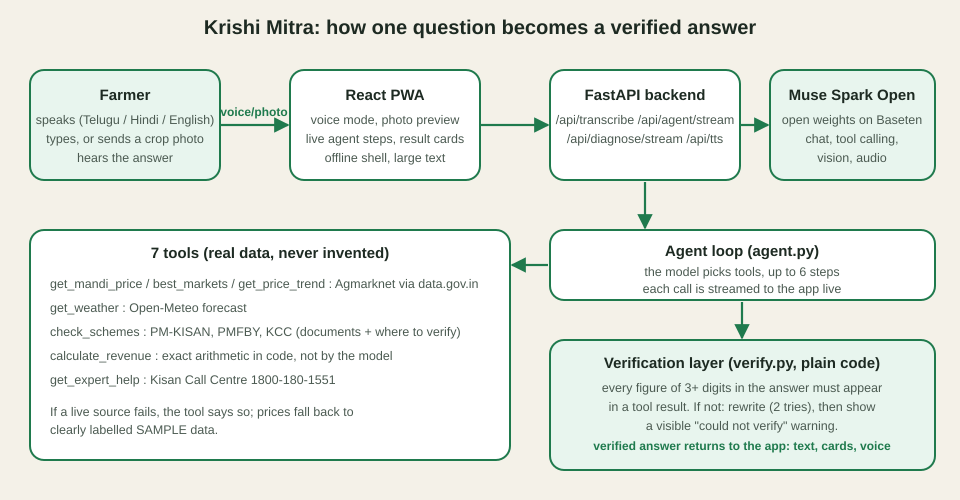

# 🌾 Krishi Mitra: a voice-first farming agent in Telugu, Hindi and English

Built for the **Meta Global AI Developer Hackathon** (Indie track, "Build for Your World").
**Everything in this repository was built during the hackathon window (Oct 27 – Nov 4, 2026).**

## The problem
Small farmers in India often cannot type long questions, read English websites, or find out which
government schemes they qualify for. Prices, weather and expert advice live in different places.
Krishi Mitra lets a farmer **speak** (or type, or send a **photo** of the crop) in their own language and get a
short, practical answer, read aloud if they want.

## What it does
- **Voice in, in any of 3 languages:** Telugu, Hindi, English (auto-detected, or pick one).
- **Photo to action plan:** one crop photo goes through the *same agent* (vision + tool calling): it names the likely problem and how sure it is, checks the weather to time spraying, mentions crop insurance if there is real loss, and sends the farmer to a human expert when unsure.
- **Multi-turn:** follow-up questions work ("and groundnut?"). Quick-ask buttons for common questions.
- **A real agent, not a chatbot:** the model decides which tools to call, in several steps:
  `get_mandi_price`, `best_markets` (where to sell for the highest price) and `get_price_trend` (rising or falling? sell now or wait?), all from Agmarknet via data.gov.in, `get_weather` (Open-Meteo),
  `check_schemes` (PM-KISAN, PMFBY, KCC, state support, with the documents needed), `calculate_revenue` (exact income maths, never done by the model), `get_expert_help` (Kisan Call Centre 1800-180-1551).
- **Live agent steps:** the answer streams its progress ("checking mandi prices… checking weather… re-checking figures") so the farmer, and the judge, can see the agent working. Endpoints: `/api/agent/stream` and `/api/diagnose/stream` (newline-delimited JSON).
- **Sell now or wait:** the agent combines the price trend, best markets and the weather forecast into one clear recommendation (guidance, not a guarantee).
- **The agent can always talk:** browser voice when the device has one for the language, otherwise a server-generated voice (`/api/tts`, gTTS), so Telugu and Hindi are audible even on laptops without those voices.
- **Works on weak networks:** installable PWA with an offline shell; saved answers stay readable and playable offline; large-text mode for older farmers.
- **Verification layer (idea from Meta's Agents 102 workshop):** every figure in the final answer must come from a tool result.
  Otherwise the answer is sent back for a rewrite, and if it still fails the farmer sees an explicit "could not verify" warning, never a confident made-up number.
- **Honest about limits:** no pesticide doses, escalates to a human expert when unsure, says when price data is sample data.
- **New chat UI:** WhatsApp-style conversation, hands-free **voice conversation mode** (listen, answer, speak, listen again, with automatic end-of-speech detection), mic button with live waveform, **photo upload** from camera, gallery or drag-and-drop with preview (add a spoken or typed question to the photo), **read-aloud** for every answer (Telugu/Hindi/English voices, auto-read option), rich cards for mandi prices, best markets, weather, schemes (with documents) and income calculator, one-tap call to the Kisan Call Centre, light/dark theme, installable as a phone app (PWA manifest).
- **Listen button** (browser speech synthesis), **share on WhatsApp**, **farmer profile** (state, district, land, crop; saved on the device), typed input fallback.

## How Meta models are used
- **Muse Spark Open** (`meta-models/muse-spark-open-1026`, open weights, served on Baseten): chat, tool calling, image understanding, and audio understanding for speech transcription.
- Provider switch in `backend/app/config.py`: `PROVIDER=baseten` (open weights) or `PROVIDER=meta` (Meta Model API).

## Architecture


React (Vite) frontend → FastAPI backend (`backend/app`) → Muse Spark Open. One Docker service serves both.
`agent.py` (tool loop + progress events) · `tools.py` (7 tools, live data with fallbacks) · `tts.py` (server voice fallback) · `verify.py` (answer verification) · `lang.py` (3 languages) · `meta_client.py` (model client, WebM→WAV conversion for audio).

## Demo and submission
See [DEMO.md](DEMO.md) for the 3-minute demo script and submission checklist.

## Tests (offline, no API key needed)
```bash
cd backend && python tests/test_verify.py && python tests/test_tools.py && python tests/test_stream.py && python tests/test_hardening.py && python tests/test_grounding.py && python tests/test_whatsapp.py
```

## Run locally
```bash
cd backend && python -m venv .venv && source .venv/bin/activate
pip install -r requirements.txt            # ffmpeg must be installed for voice
cp ../.env.example .env                    # add BASETEN_API_KEY (and optional DATA_GOV_API_KEY)
uvicorn app.main:app --reload --port 8000
cd ../frontend && npm install && npm run dev
```
Without an API key the app runs in **mock mode** (fake answers, for UI development only).

## Deploy (Render)
Docker web service using the root `Dockerfile`. Environment variables: `PROVIDER=baseten`, `BASETEN_API_KEY`,
`OPEN_MODEL=meta-models/muse-spark-open-1026`, optional `DATA_GOV_API_KEY` (free key from data.gov.in for live mandi prices).

## WhatsApp channel (Meta WhatsApp Cloud API)
Farmers who will not install an app can use the same agent on WhatsApp: send a **text**, a **voice note** (answered in text and a voice reply) or a **crop photo**. Same tools, same verification layer (`backend/app/whatsapp.py`).
1. developers.facebook.com → create an app → add the **WhatsApp** product → use the test number.
2. Set on Render: `WHATSAPP_ACCESS_TOKEN`, `WHATSAPP_PHONE_NUMBER_ID`, `WHATSAPP_APP_SECRET` (App settings → Basic), `WHATSAPP_VERIFY_TOKEN` (any string you choose). Optional: `WHATSAPP_ALLOWED_NUMBERS` (comma separated, digits only) to restrict who can use the bot, `WHATSAPP_VOICE_REPLY=0` to turn voice replies off.
3. WhatsApp → Configuration: callback URL `https://<your-app>.onrender.com/webhook/whatsapp`, the same verify token, then subscribe to the **messages** field.
4. Add your phone as a test recipient and send "hi". Commands: `/district Kurnool`, `/crop Groundnut`, `/land yes`, `/reset`, `/help`.
Safety: requests are accepted only with a valid `X-Hub-Signature-256`, duplicate deliveries are answered once, each sender is rate limited, and no tokens are stored in the repo. The temporary token expires in 24 hours; for a longer demo create a System User token.

## Stronger verification and saved data
- **Field-aware verification:** money figures must come from a price/amount field in a tool result (a year, phone number or rain percentage cannot be passed off as a price); percentages, temperatures and rainfall must match a weather/trend field (rounding allowed); other 3+ digit numbers must appear in a tool result. The result reports how many figures were checked.
- **Saved real data, never invented:** if data.gov.in is slow or down, the agent uses a dated snapshot of real Agmarknet prices (`python scripts/snapshot_mandi.py`, needs your free `DATA_GOV_API_KEY`), labelled "Saved data" in the UI and in the answer. Only if no snapshot exists does it fall back to clearly-labelled sample data.

## Production safety
- Per-IP rate limits on the model, voice and TTS endpoints (default 12 agent requests/min, 20 voice requests/min; `RATE_AGENT_PER_MIN`, `RATE_VOICE_PER_MIN`), so a public demo URL cannot burn the API credits.
- Public data (Agmarknet, weather) is cached for 10 minutes (`CACHE_TTL_S`, 0 = off); failed lookups are never cached.
- Independent tool calls from one model turn run in parallel.
- `/api/debug/*` and `/api/models` are hidden unless `DEBUG_ENDPOINTS=1`.
- CI (GitHub Actions) runs the offline tests and the frontend build on every push.

## Data honesty
- Mandi prices are live only when `DATA_GOV_API_KEY` is set and data.gov.in responds; otherwise the tool returns clearly labelled **sample data**.
- Scheme details are indicative and must be confirmed with the official office (links are returned by the tool).

## Progress log
- Day 1 (Oct 27): repo scaffold, FastAPI backend, Meta API client, voice-record UI, crop photo upload.
- Day 2 (Oct 28): agent loop with tools, mock mode, Baseten provider switch, answer verification layer, Docker deploy.
- Day 3 (Oct 29): photo-to-action-plan through the agent, multi-turn, best markets, revenue calculator, scheme documents, WhatsApp share, quick-ask buttons, transcription guard, image shrinking. Also: Telugu/English/Hindi, typed input, WebM→WAV audio fix for Baseten, weather + expert-help + live mandi tools, farmer profile, listen button.
